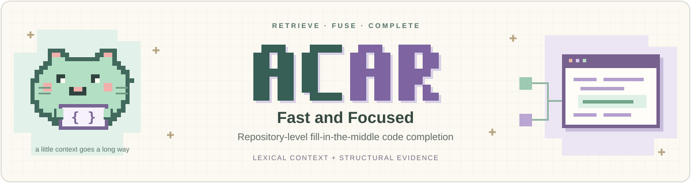
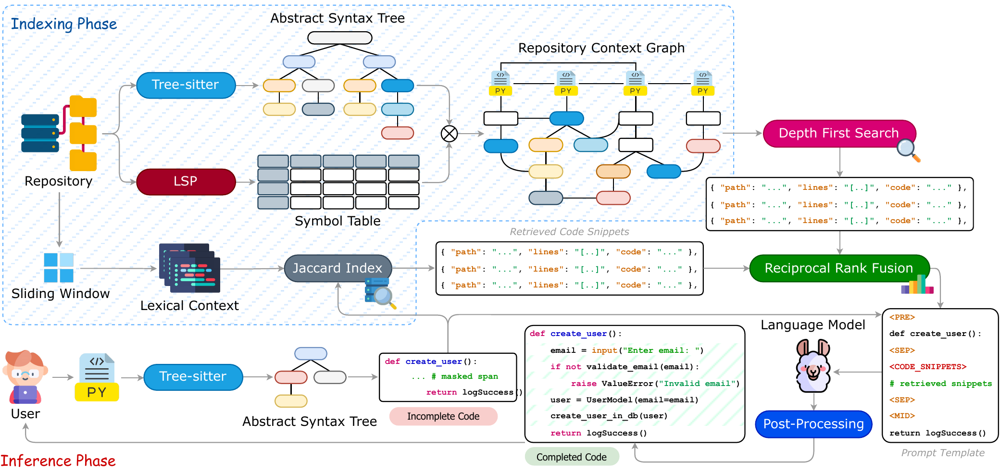

<div align="center">



### Interactive Repository-Level Fill-in-the-Middle Code Completion<br>with Hybrid Structural Retrieval


[](#quickstart)
[](LICENSE)
[](#method)

**[Overview](#overview) · [Method](#method) · [Quickstart](#quickstart) · [Configuration](#configuration) · [Datasets](#datasets) · [Evaluation](#evaluation) · [Results](#results) · [Findings](#findings) · [Adapt & Extend](#adapting-acar) · [Citation](#citation)**

Long S. T. Nguyen<sup>1,2,3</sup> · Dat T. Huynh<sup>1,2</sup> · Quynh T. N. Vo<sup>1,2,3</sup> · Dang Le<sup>4</sup><br>
Cong-Duy Nguyen<sup>3</sup> · Anh Tuan Luu<sup>5,3</sup> · Anh Nguyen-Duc<sup>6</sup> · Tho T. Quan<sup>1,2</sup>

<sub><sup>1</sup> URA Research Group, Ho Chi Minh City University of Technology (HCMUT), Vietnam<br>
<sup>2</sup> Vietnam National University Ho Chi Minh City, Vietnam · <sup>3</sup> Center for AI Research (CAIR), VinUniversity, Vietnam<br>
<sup>4</sup> Japan Advanced Institute of Science and Technology (JAIST), Japan<br>
<sup>5</sup> Nanyang Technological University (NTU), Singapore · <sup>6</sup> University of South-Eastern Norway (USN), Norway</sub>

</div>

## Overview

**ACAR retrieves repository evidence for the code missing between a prefix and a suffix.** Lexical retrieval finds recurring implementations; structural retrieval follows symbols across files. The framework combines their evidence before generation and refines the resulting insertion using the surrounding syntax.

The paper evaluates RepoEval, ReccEval, and CrossCodeEval with five Qwen and DeepSeek backbones. At Qwen2.5-Coder-3B, ACAR reaches 42.98 Exact Match on ReccEval and 32.86 on CrossCodeEval. Reported warm-cache overhead is 87–95 ms across the three benchmarks, excluding model decoding.

This repository contains retrieval modules, FIM prompt templates, inference helpers, and syntax-aware post-processing. Start with the small CPU example, then use the JSONL workflow for your own Python repositories.

## Method

<p align="center">
<a href="docs/assets/architecture.pdf"></a>
</p>

| Stage | Purpose | Entry point |
| :--- | :--- | :--- |
| Lexical retrieval | Rank sliding windows by Jaccard similarity to the prefix. | [`JaccardSimilarityRetriever`](text_retrieval/jaccard_retriever.py) |
| Structural retrieval | Resolve nearby identifiers and follow symbol definitions. | [`LsptRetriever`](graph_retrieval/lsp.py) |
| Context fusion | Combine evidence using shared source-line identities. | [`ContextMixer`](context_mixer.py), [`fuse_results`](ranking/reciprocal_rank_fusion.py) |
| FIM generation | Serialize retrieved context, filename, prefix, and suffix. | [`CodeQwen25PromptExtractor`](prompt/fim_utils.py), [`QwenInference`](inference/qwen_inference.py) |
| Refinement | Truncate the insertion using AST boundaries and trim overlap. | [`parse_and_truncate_completion`](post_processing/parse_and_truncate_completion.py), [`process_completion`](post_processing/process_inline_completion.py) |

Line-level reciprocal rank fusion (RRF) rewards evidence supported by both retrievers and reconstructs adjacent selected lines into contiguous code spans.

## Quickstart

Run commands from the repository root. The CPU example uses Python 3.9+ and the pinned Tree-sitter 0.20.4 API. It downloads the NLTK stopword list on first use and runs on a CPU.

### 1. Install the example dependencies

```bash
git clone https://github.com/longstnguyen/ACAR.git
cd ACAR
python3 -m venv .venv
source .venv/bin/activate
python -m pip install -r requirements-demo.txt
```

### 2. Retrieve context and refine one insertion

```bash
python -m scripts.demo --output-dir result/demo
```

The example retrieves `shop/pricing.py` for an insertion in `shop/cart.py`, builds a Qwen2.5-Coder FIM prompt, and refines a fixed completion fixture containing an extra function. This exercises lexical retrieval, prompt formatting, and AST refinement. For model generation and hybrid prompt construction, continue with the [model workflow](#run-with-a-model).

Use a new output directory for each run.

### 3. Inspect and score the output

```bash
python -m scripts.evaluate --input result/demo/refined.jsonl
```

| Output | Contents |
| :--- | :--- |
| `result/demo/prompts.jsonl` | Source record, retrieved `contexts`, and FIM `prompt`. |
| `result/demo/raw.jsonl` | The same record with the explicit completion fixture in `choices[0].text`. |
| `result/demo/refined.jsonl` | The record with its refined insertion. |

<details>
<summary>Example terminal output</summary>

```text
ACAR | lexical retrieval + syntax-aware refinement
Mode: CPU example; fixed completion fixture; no model or LSP
Target: shop/cart.py:5
Retrieved: 1 snippet(s)
  shop/pricing.py | lines 1-4
Prompt: Qwen2.5-Coder FIM with retrieved context
Raw fixture: 'discounted_total(price, quantity, discount)\n\ndef unrelated():\n    pass'
Refined: 'discounted_total(price, quantity, discount)'
Output: result/demo
```

</details>

## Run with a Model

Install the full dependencies for structural retrieval and model generation:

```bash
python -m pip install -r requirements.txt
```

The hybrid prompt builder uses `multilspy` and `jedi-language-server`, installed by the full requirements. Keep the virtual environment activated so the server executable is on `PATH`. Each source repository gets its own cached LSP workspace. The batch workflow below processes Python repositories.

### 1. Build one hybrid prompt

The demo's prompt record also supplies the metadata needed by the hybrid builder:

```bash
python -m scripts.build_prompts \
  --base_dir examples/repository \
  --input result/demo/prompts.jsonl \
  --output result/demo/hybrid_prompts.jsonl
```

`--base_dir` supplies the source root for both target-file lookup and lexical retrieval. The builder uses the selected Qwen tokenizer to fit 2,048 tokens of retrieved context within an 8,000-token prompt. It preserves input fields and adds `prompt`, `contexts`, and token counts. Use the same `--model` checkpoint for prompt construction and generation.

### 2. Generate an insertion

```bash
python -m inference.qwen_inference \
  --input result/demo/hybrid_prompts.jsonl
```

This loads `Qwen/Qwen2.5-Coder-0.5B` from Hugging Face and writes `result/demo/hybrid_prompts_Qwen2.5-Coder-0.5B.jsonl`. The helper processes records individually, samples up to 48 new tokens with temperature 0.2 and top-k 5 by default. Generation stops at end-of-text, FIM, or file-separator tokens. A CUDA GPU is recommended; model placement uses `device_map="auto"`.

### 3. Refine and evaluate

```bash
python -m scripts.post_process_jsonl \
  --base_dir examples/repository \
  --input result/demo/hybrid_prompts_Qwen2.5-Coder-0.5B.jsonl \
  --output result/demo/hybrid_refined.jsonl

python -m scripts.evaluate --input result/demo/hybrid_refined.jsonl
```

Inspect any `error` records or `ERROR:` completions before scoring. Use a separate directory for each experiment: the batch writers overwrite their specified output files.

<details>
<summary>Select another Qwen checkpoint or generation length</summary>

```python
from inference.qwen_inference import QwenInference

model = QwenInference(model_name="Qwen/Qwen2.5-Coder-3B")
output_path = model.process_file(
    "result/demo/hybrid_prompts.jsonl",
    max_new_tokens=48,
)
print(output_path)
```

Pass `--model`, `--max-new-tokens`, `--temperature`, and `--top-k` to the CLI to customize generation. Set `--temperature 0` for greedy decoding; `--seed` defaults to 42.

</details>

## Configuration

Configure batch runs through the CLI and retrieval through Python constructors.

| Setting | Current value / interface | Location |
| :--- | :--- | :--- |
| Lexical corpus root | `--base_dir`; `ACAR_BASE_DIR` is the direct `ContextMixer()` fallback | [`context_mixer.py`](context_mixer.py) |
| Target file root | Required `--base_dir` | [`scripts/build_prompts.py`](scripts/build_prompts.py) |
| Query and candidate windows | 50 lines | [`JaccardSimilarityRetriever`](text_retrieval/jaccard_retriever.py) |
| Sliding step | 10 lines | `JaccardSimilarityRetriever(slide=...)` |
| Lexical candidates | Top 10 globally; up to 20 non-overlapping windows per file | `max_chunk_result`, `max_matches_per_file` |
| Structural expansion | One nearby call; depth 2; up to 10 source bodies | [`graph_retrieval/lsp.py`](graph_retrieval/lsp.py) |
| RRF damping | `RRF_K = 60` | [`ranking/reciprocal_rank_fusion.py`](ranking/reciprocal_rank_fusion.py) |
| Retrieved-context budget | 2,048 tokens including file headers; `--context-budget` | [`prompt/budget.py`](prompt/budget.py) |
| Total prompt budget | 8,000 tokens; `--input-budget` | [`scripts/build_prompts.py`](scripts/build_prompts.py) |
| Qwen input | `--input`; falls back to `ACAR_QWEN_INPUT` | [`inference/qwen_inference.py`](inference/qwen_inference.py) |
| Checkpoint | `Qwen/Qwen2.5-Coder-0.5B` | `QwenInference(model_name=...)` |
| Generation | Up to 48 tokens; temperature 0.2; top-k 5 | `QwenInference.process_file()` |

<details>
<summary>FIM templates and SAFIM workflow</summary>

[`prompt/fim_utils.py`](prompt/fim_utils.py) defines Qwen2.5, earlier Qwen, DeepSeek, StarCoder, Code Llama, CodeGemma, and plain left-context templates. The batch prompt builder selects `CodeQwen25PromptExtractor`; changing templates requires selecting the appropriate extractor in the caller and using a compatible model.

For SAFIM-format generations, use the separate adapter:

```bash
python -m scripts.post_process_safim \
  --input result/qwen-safim-infillng.jsonl \
  --output result/qwen-safim-infillng-post_processed.jsonl
```

This adapter loads SAFIM data through [`pipelines/process_data.py`](pipelines/process_data.py).

</details>

## Datasets

ACAR is evaluated on three repository-level code completion benchmarks. RepoEval [1] covers three target granularities, ReccEval [2] emphasizes Python cross-file dependencies, and CrossCodeEval [3] spans four languages.

| Benchmark | Language | Repositories | Completion instances | Task |
| :--- | :--- | ---: | ---: | :--- |
| RepoEval — line | Python | 8 | 1,600 | Line insertion |
| RepoEval — API | Python | 8 | 1,600 | API invocation |
| RepoEval — function | Python | 8 | 455 | Function body |
| ReccEval | Python | 2,635 | 6,461 | Line completion |
| CrossCodeEval | Python | 471 | 2,665 | Cross-file completion |
| CrossCodeEval | Java | 239 | 2,139 | Cross-file completion |
| CrossCodeEval | TypeScript | 193 | 3,356 | Cross-file completion |
| CrossCodeEval | C# | 99 | 1,768 | Cross-file completion |

Counts follow the paper's Benchmark Statistics appendix. RepoEval's eight repositories are shared across its tasks. The reported total is 20,044 instances across 3,645 repositories, counting those eight once.

### Obtain the benchmarks

Use the original distributions and their evaluation instructions:

- [1] [RepoEval / RepoCoder](https://github.com/microsoft/CodeT/tree/main/RepoCoder): completion records and repository-level evaluation resources.
- [2] [ReccEval / DraCo](https://github.com/nju-websoft/DraCo/tree/main/ReccEval): Python source archives and completion metadata.
- [3] [CrossCodeEval](https://github.com/amazon-science/cceval): multilingual completion records and repository acquisition instructions.

The download helper fetches the configured archives into `datasets/RepoEval`, `datasets/ReccEval`, and `datasets/CrossCodeEval`:

```bash
bash scripts/download_datasets.sh
```

It requires Bash 4+, `curl` or `wget`, `unzip`, and `tar` with xz support. Run it in a fresh dataset directory; extraction may overwrite existing files. Source-repository acquisition and conversion into the input schema below remain benchmark-specific. Dataset terms are separate from the code's MIT license.

## Evaluation

The scorer reads a JSONL file containing `choices[0].text` and a reference field:

```bash
python -m scripts.evaluate \
  --input result/demo/refined.jsonl \
  --reference-field groundtruth
```

| Metric | Definition | Scale |
| :--- | :--- | :--- |
| Exact Match (EM) | Fraction of predictions identical to the reference. | 0–100, higher is better |
| Edit Similarity (ES) | Mean of `1 - Levenshtein(prediction, reference) / max(lengths)`. | 0–100, higher is better |

Scoring preserves whitespace and compares Unicode characters. Two empty strings have similarity 1. The output includes the evaluated count `n`; resolve malformed records and pipeline errors before scoring.

For CrossCodeEval, score each language separately and take the unweighted mean of the four language scores. The JSONL scorer averages over instances within each file.

### Benchmark protocol

Use the same examples, checkpoint, input budget, decoding configuration, and normalization for every method. Keep raw and refined completions separately so that retrieval and post-processing effects can be examined independently. Record the code revision, package versions, language-server environment, and retained instance IDs with each run.

The paper reports unquantized models, an 8,000-token input budget, a 2,048-token retrieved-context budget, 48 generated tokens, temperature 0.2, and top-k 5. Retrieval uses 50-line windows with step 10, top-k 10 for each branch, depth 2, and RRF constant 60.

## Results

Results from the paper are summarized below. EM and ES use a 0–100 scale; differences are absolute score points. CrossCodeEval aggregate scores are macro-averages over Python, Java, TypeScript, and C#.

### Main comparison — Qwen2.5-Coder-3B

Each cell is **EM / ES**. **Bold** marks the best value and <ins>underlining</ins> marks the second-best, ranked separately for each metric among the methods shown. Ties share the same formatting.

| Method | RepoEval line | RepoEval API | RepoEval function | ReccEval | CrossCodeEval |
| :--- | :---: | :---: | :---: | :---: | :---: |
| RepoCoder | **38.03** / <ins>67.43</ins> | <ins>28.32</ins> / 56.23 | 2.32 / 34.38 | 30.10 / 66.94 | 16.85 / 67.54 |
| Repoformer | 34.68 / 64.27 | 26.82 / <ins>62.11</ins> | <ins>6.14</ins> / <ins>56.20</ins> | <ins>36.25</ins> / <ins>69.20</ins> | <ins>28.40</ins> / <ins>71.45</ins> |
| RLCoder | 10.41 / 33.12 | 13.11 / 28.79 | 0.66 / 12.21 | 13.76 / 55.18 | 12.78 / 62.74 |
| CodeRAG | 14.18 / 46.19 | 14.17 / 54.87 | 0.31 / 31.63 | 23.82 / 63.33 | 16.66 / 66.20 |
| DraCo | 34.92 / 55.95 | 27.95 / 57.72 | 2.64 / 34.83 | 33.27 / 68.38 | 22.97 / 69.75 |
| GraphCoder | 32.97 / 61.48 | 25.86 / 61.72 | 5.29 / 54.61 | 33.71 / 68.02 | 23.94 / 69.02 |
| CoCoMIC | 34.48 / 53.90 | 28.16 / 55.23 | 2.33 / 34.23 | 20.85 / 62.59 | 13.49 / 63.98 |
| **ACAR** | <ins>37.50</ins> / **69.52** | **29.04** / **68.43** | **8.35** / **59.60** | **42.98** / **72.46** | **32.86** / **74.34** |

Source: Tables 1–3 in the paper. Parser-dependent baseline results exclude failed instances and use method-specific subsets. ACAR's multilingual scores use full coverage; see the paper's Multilingual Baseline Adaptation appendix for retained counts and adapter details.

<details>
<summary>Qwen2.5-Coder-0.5B comparison</summary>

| Method | RepoEval line | RepoEval API | RepoEval function | ReccEval | CrossCodeEval |
| :--- | :---: | :---: | :---: | :---: | :---: |
| RepoCoder | 24.58 / **58.56** | 16.78 / 48.78 | 2.12 / 32.78 | 24.57 / 62.82 | 12.97 / 63.93 |
| Repoformer | <ins>28.12</ins> / 52.34 | 18.11 / <ins>55.45</ins> | <ins>3.83</ins> / <ins>48.92</ins> | <ins>27.97</ins> / **63.41** | <ins>19.40</ins> / <ins>66.10</ins> |
| RLCoder | 8.63 / 34.99 | 11.44 / 31.84 | 0.00 / 13.42 | 7.51 / 48.75 | 7.07 / 56.23 |
| CodeRAG | 10.38 / 42.31 | 11.13 / 49.08 | 0.00 / 29.75 | 13.99 / 54.50 | 9.71 / 59.78 |
| DraCo | 18.75 / 42.38 | 17.69 / 45.18 | 2.22 / 32.17 | 26.25 / 60.95 | 17.61 / 64.56 |
| GraphCoder | 26.91 / 50.88 | 17.94 / 53.47 | 2.86 / 46.73 | 25.83 / <ins>62.94</ins> | 16.72 / 65.26 |
| CoCoMIC | 23.51 / 44.38 | <ins>18.16</ins> / 44.30 | 1.47 / 30.04 | 14.43 / 56.36 | 9.85 / 60.45 |
| **ACAR** | **33.62** / <ins>54.65</ins> | **19.96** / **59.57** | **5.27** / **51.71** | **30.21** / 61.03 | **22.13** / **67.38** |

</details>

### Multilingual completion

ACAR on CrossCodeEval, reported as EM / ES across model sizes. Source: Table 4 in the paper.

| Backbone | Python | Java | TypeScript | C# | Macro-average |
| :--- | :---: | :---: | :---: | :---: | :---: |
| Qwen2.5-Coder-0.5B | 28.74 / 75.56 | 17.63 / 65.99 | 20.67 / 63.37 | 21.49 / 64.61 | 22.13 / 67.38 |
| Qwen2.5-Coder-3B | 39.89 / 75.56 | 29.31 / 73.82 | 26.43 / 73.33 | 35.80 / 74.66 | 32.86 / 74.34 |

### Retrieval and refinement overhead

Milliseconds per completion, under warm-cache conditions, excluding decoding. All methods use a 2,048-token retrieved-context budget in this timing study. Source: Figure 4 and the Efficiency and Scalability section. Lower is better.

| Method | ReccEval | RepoEval | CrossCodeEval |
| :--- | ---: | ---: | ---: |
| **ACAR** | **89** | **87** | **95** |
| Repoformer | <ins>100</ins> | <ins>98</ins> | <ins>105</ins> |
| RepoCoder | 312 | 308 | 332 |
| DraCo | 328 | 320 | 327 |
| GraphCoder | 530 | 520 | 540 |
| RLCoder | 1,215.8 | 804.6 | 1,100.2 |
| CodeRAG | 2,140.6 | 2,291.1 | 2,441.0 |
| CoCoMIC | 4,743 | 4,025 | 4,113 |

Measured on an AMD EPYC 7V13 with 24 allocated CPU cores, an NVIDIA A100 80 GB, and 512 GB RAM.

## Findings

- **Hybrid retrieval improves completion quality.** At Qwen2.5-Coder-3B, ACAR gains **6.73 EM points** on ReccEval and **4.46** on aggregate CrossCodeEval over the strongest retrieval baseline. Across the two main Qwen scales, it leads **5 of 6** RepoEval settings for each metric.

- **Lexical and structural evidence complement each other.** ReccEval EM at 3B reaches **42.98** with both branches, compared with **39.24** for text-only and **38.49** for graph-only. All three variants use the same post-processing.

- **Syntax-aware refinement makes insertions more precise.** Removing it lowers 3B ES from **72.46 → 54.28** on ReccEval, **74.34 → 65.40** on CrossCodeEval, and **69.52 → 54.65** on RepoEval-line. Its effect depends on the generation pipeline: transfer to Repoformer and GraphCoder produces mixed results.

- **Backbone capacity and completion type shape retrieval gains.** With the largest tested Qwen and DeepSeek backbones, ACAR improves EM over standalone generation in **all five settings**. Smaller Qwen models favor standalone generation on short RepoEval line and API targets, motivating selective retrieval.

- **Structural context stays lightweight as repositories grow.** Benchmark overhead is **87–95 ms** with warm caches, excluding decoding. Aggregate stress tests span **12k–117k files**, with retrieval taking **0.77–1.83 s** and the LSP branch contributing at most **178 ms**; lexical scanning accounts for most of the growth.

- **Longer synthesis benefits from reusable repository evidence.** Under Qwen2.5-Coder-7B, function-level EM is **28.57** overall and **10.66** on records without detected retrieved-answer overlap. ReccEval changes only slightly, from **44.33 → 43.89**. These subsets also differ in task difficulty.

<details>
<summary>Component ablation — Qwen2.5-Coder-3B</summary>

EM / ES, from Tables 1–3 in the paper. Text-only and graph-only retain post-processing.

| Variant | RepoEval line | RepoEval API | RepoEval function | ReccEval | CrossCodeEval |
| :--- | :---: | :---: | :---: | :---: | :---: |
| Text-only | <ins>37.27</ins> / <ins>63.84</ins> | <ins>26.44</ins> / <ins>67.03</ins> | <ins>6.11</ins> / <ins>57.80</ins> | <ins>39.24</ins> / <ins>64.82</ins> | <ins>30.73</ins> / <ins>70.87</ins> |
| Graph-only | 36.77 / 62.34 | 25.94 / 66.53 | 5.81 / 57.30 | 38.49 / 63.37 | 30.43 / 69.37 |
| Without post-processing | 33.62 / 54.65 | 22.84 / 54.47 | 4.62 / 54.99 | 33.99 / 54.28 | 28.59 / 65.40 |
| **Full ACAR** | **37.50** / **69.52** | **29.04** / **68.43** | **8.35** / **59.60** | **42.98** / **72.46** | **32.86** / **74.34** |

</details>

<details>
<summary>Backbone scaling — EM gains over standalone</summary>

Absolute EM points, from the paper's Backbone Scaling Results appendix. CrossCodeEval here is Python only.

| Backbone | RepoEval line | RepoEval API | RepoEval function | CrossCodeEval Python | ReccEval |
| :--- | ---: | ---: | ---: | ---: | ---: |
| Qwen2.5-Coder-0.5B | -3.13 | -4.35 | +2.85 | +8.59 | +9.61 |
| Qwen2.5-Coder-3B | -16.06 | -7.52 | +3.30 | +9.16 | +11.50 |
| Qwen2.5-Coder-7B | +9.46 | +10.10 | +20.66 | +28.82 | +10.12 |
| DeepSeek-Coder-1.3B | +13.60 | +9.22 | +1.10 | +8.45 | +13.50 |
| DeepSeek-Coder-6.7B | +16.81 | +15.69 | +9.67 | +14.56 | +18.45 |

</details>

## Adapting ACAR

### 1. Prepare repository files and completion records

Place each source repository beneath a common root, retaining its import structure:

```text
examples/repository/
└── shop/
    ├── cart.py
    └── pricing.py
```

Each JSONL line describes one insertion. The minimal record for the bundled example is:

```json
{
  "prefix": "from pricing import discounted_total\n\n\ndef checkout(price, quantity, discount):\n    return ",
  "suffix": "\n",
  "groundtruth": "discounted_total(price, quantity, discount)",
  "metadata": {
    "fpath_tuple": ["shop", "cart.py"],
    "line_no": 4,
    "context_start_characterno": 11
  }
}
```

The expanded JSON above is for readability; serialize each record onto a single line in a `.jsonl` file.

| Field | Meaning |
| :--- | :--- |
| `prefix` | Visible code before the insertion; retain indentation. |
| `suffix` | Visible code after the insertion. |
| `metadata.fpath_tuple` | Path components relative to `--base_dir`; the first identifies the repository. |
| `metadata.line_no` | Zero-based cursor line in `prefix + suffix`. |
| `metadata.context_start_characterno` | Zero-based cursor column, using the same source text. |
| `groundtruth` | Held-out reference used only for scoring; optional during prompt construction. |
| `choices[0].text` | Raw model insertion, required for refinement and scoring. |

For new data, compute the cursor from the actual prefix: line is `prefix.count("\n")` and column is `len(prefix.rsplit("\n", 1)[-1])`. The pipeline constructs `document.text = prefix + suffix` and `offset = len(prefix)`, so coordinates must refer to that reconstructed text. For non-ASCII code, verify byte and language-server position conventions in your adapter.

### 2. Keep retrieval evidence separate from the target

Remove the held-out answer from the source snapshot used by retrieval and keep it only in the scoring field. The lexical retriever excludes the active file; the language server can still read files from disk. Ensure those files reflect the incomplete input, and keep the source prefix and suffix aligned with the file's contents and symbol positions.

### 3. Run a small sample before scaling

Convert one or two records into the schema, pass the source root with `--base_dir`, and follow [Run with a Model](#run-with-a-model). Inspect retrieved paths, insertion coordinates, generated text, and refinement before extending to a whole dataset. Save failures with their instance IDs and report evaluation coverage.

## Extending ACAR

Extend ACAR through the modules below and connect each implementation at its caller.

| Extension | Entry points | Integration steps |
| :--- | :--- | :--- |
| New lexical retriever | [`text_retrieval/`](text_retrieval), [`ContextMixer`](context_mixer.py) | Implement `identifier` and async `retrieve(document, position, repo)`. Return snippets with URI, content, line span, and `to_dict()`, then register the instance in `self.retrievers`. |
| Ranking or context selection | [`fuse_results`](ranking/reciprocal_rank_fusion.py), `ContextMixer.get_context()` | Preserve candidate order, define line identities and tie-breaking, and apply a budget before prompt serialization. |
| Another FIM backbone | [`FIMModelSpecificPromptExtractor`](prompt/fim_utils.py) | Implement the model's special-token format and snippet serialization, select the extractor in the prompt builder, and pair it with its tokenizer and generation helper. |
| Another source language | [`programming_language/`](programming_language), [`tree_sitter_local/`](tree_sitter_local), [`graph_retrieval/`](graph_retrieval), [`text_retrieval/tool.py`](text_retrieval/tool.py) | Add syntax queries and node types, language-server support, file extensions, and language-aware batch records. Test symbol resolution and insertion boundaries together. |
| Another dataset schema | [`pipelines/prompt_builder.py`](pipelines/prompt_builder.py), [`pipelines/post_process_jsonl.py`](pipelines/post_process_jsonl.py) | Convert to the documented record schema and preserve IDs, prefixes, suffixes, coordinates, and references through inference. |
| Another metric | [`scripts/evaluate.py`](scripts/evaluate.py) | Add scoring with explicit normalization and failure handling; report the denominator and aggregation unit. |

## Development

Install the relevant requirements, then run the focused checks:

```bash
python -m unittest discover -s tests -v
python -m scripts.demo --output-dir result/dev-check
python -m scripts.evaluate --input result/dev-check/refined.jsonl
python -m scripts.build_prompts --help
python -m scripts.post_process_jsonl --help
python -m scripts.post_process_safim --help
```

The `test/` directory contains small repository fixtures for symbol resolution. The `tests/` directory contains automated checks. The CPU demo covers retrieval, prompt construction, and refinement together.

<details>
<summary>Code structure</summary>

```text
context_mixer.py              Retrieval orchestration and line selection
text_retrieval/               Jaccard scoring and source-file discovery
graph_retrieval/              Identifier extraction and LSP symbol context
ranking/                     Reciprocal rank fusion
prompt/                      FIM templates and tokenizer-based budgets
inference/                   Model loading and generation
post_processing/             AST truncation and overlap trimming
context/                     Prefix/suffix and multiline analysis
schema/                      Documents, positions, and snippet records
tree_sitter_local/           Parser and syntax queries
programming_language/        Language-specific syntax settings
pipelines/                   JSONL and SAFIM workflows
scripts/                     CLI wrappers, demo, scoring, and downloads
examples/                    Small Python repository for the quickstart
test/                        Existing symbol-resolution fixtures
tests/                       Automated checks
docs/assets/                 Pixel banner and original framework figure
```

</details>

### Troubleshooting

| Symptom | Check |
| :--- | :--- |
| Empty lexical context | Check `--base_dir`, `fpath_tuple[0]`, and the Python source files beneath that root. |
| Empty structural context | Check `jedi-language-server --help` in the active environment, source imports, workspace location, and cursor positions. Check the reported lookup error if definitions are unavailable. |
| Tree-sitter API error | Install the pinned `tree_sitter==0.20.4` and `tree_sitter_languages==1.10.2` pair in the active environment. |
| NLTK resource error | Run `python -m nltk.downloader stopwords` in that environment and ensure the resources are accessible to the runtime. |
| Missing output directory | Create the parent directory before using the batch scripts. The demo creates its own output directory. |
| Model memory error | Start with the 0.5B checkpoint and a short prompt; reduce generation length and verify available device memory. |
| Evaluation rejects a record | Resolve its pipeline error or supply the missing reference. |

## Citation

ACAR accompanies **Fast and Focused: Interactive Repository-Level Fill-in-the-Middle Code Completion with Hybrid Structural Retrieval**, accepted to **EMNLP 2026, Main Conference, Oral**.

```bibtex
@inproceedings{nguyen2026acar,
  title = {Fast and Focused: Interactive Repository-Level Fill-in-the-Middle Code Completion with Hybrid Structural Retrieval},
  author = {Nguyen, Long S. T. and Huynh, Dat T. and Vo, Quynh T. N. and Le, Dang and Nguyen, Cong-Duy and Luu, Anh Tuan and Nguyen-Duc, Anh and Quan, Tho T.},
  booktitle = {Proceedings of the 2026 Conference on Empirical Methods in Natural Language Processing},
  year = {2026}
}
```

Machine-readable metadata is available in [`CITATION.cff`](CITATION.cff).

## License

Code is released under the [MIT License](LICENSE), copyright © 2026 Long S. T. Nguyen. Benchmark datasets, source repositories, and model checkpoints retain their respective licenses and usage conditions.

## References

[1] Fengji Zhang et al. [RepoCoder: Repository-Level Code Completion Through Iterative Retrieval and Generation](https://aclanthology.org/2023.emnlp-main.151/). EMNLP, 2023.

[2] Wei Cheng, Yuhan Wu, and Wei Hu. [Dataflow-Guided Retrieval Augmentation for Repository-Level Code Completion](https://aclanthology.org/2024.acl-long.431/). ACL, 2024.

[3] Yangruibo Ding et al. [CrossCodeEval: A Diverse and Multilingual Benchmark for Cross-File Code Completion](https://github.com/amazon-science/cceval). NeurIPS Datasets and Benchmarks, 2023.
